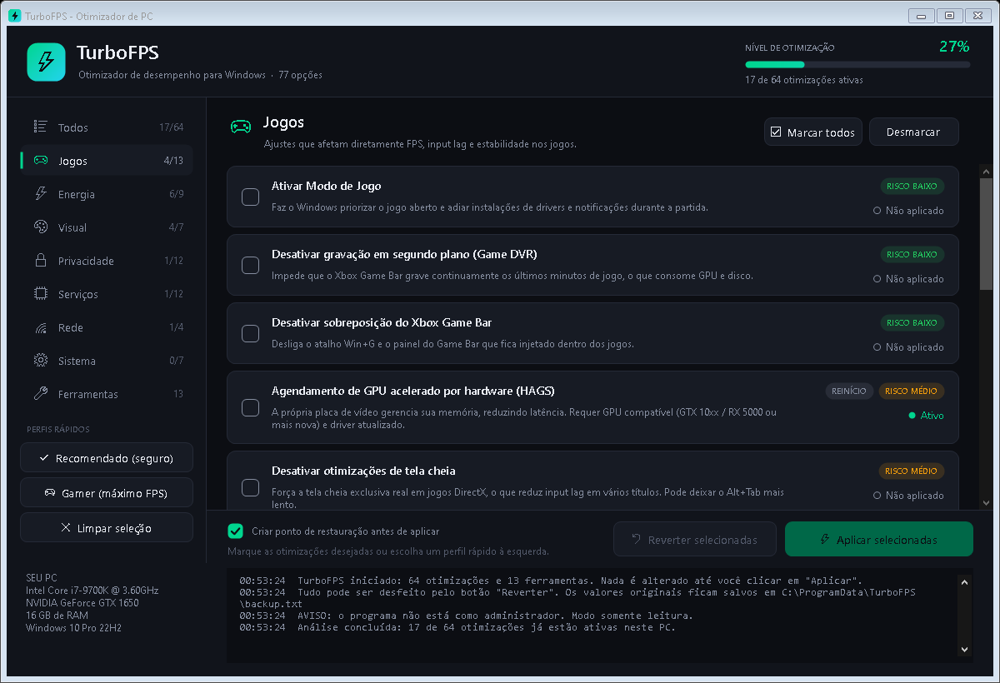

# TurboFPS: PC optimizer for Windows 10 and 11

[Português](README.md) · **English**



A single small program (`TurboFPS.exe`, ~120 KB) with **77 options**: 64 reversible tweaks and 13 cleanup and maintenance tools. Nothing to install: it runs on the .NET Framework 4.8 that ships with Windows. The interface is in Brazilian Portuguese.

**Download:** get `TurboFPS.exe` from the [Releases](../../releases/latest) page. GitHub Actions builds it from this source, and the `.sha256` file next to it lets you verify the download.

**Why you can trust it:** the code is short and open, every change saves the original value so the Revert button restores it exactly, and it never disables Defender, the firewall, UAC or security updates.

## How to use

1. Run `TurboFPS.exe`. It asks for administrator rights, because it changes the registry, services and power plan.
2. Pick a **quick profile** on the left, or tick options one by one:
   - **Recomendado (safe):** low-risk items only. On laptops it skips items that drain the battery.
   - **Gamer (max FPS):** low and medium risk.
   - **High-risk** items are never ticked automatically and always ask for confirmation.
3. Click **Aplicar selecionadas** (Apply). By default a Windows restore point is created first.
4. Restart when asked. Items tagged "REINÍCIO" only take effect after a restart.

**To undo**, tick an item marked "Ativo" (active) and click **Reverter** (Revert). Original values are stored in `C:\ProgramData\TurboFPS\backup.txt`, and a log is kept in `C:\ProgramData\TurboFPS\log.txt`.

## What it changes

| Category | Count | Examples |
|---|---|---|
| Games | 13 | Game Mode, Game DVR off, MMCSS game priority, HAGS, mouse acceleration off, MPO off, Memory Integrity off (high risk) |
| Power | 9 | Ultimate Performance plan, no power throttling, no core parking, USB selective suspend off, PCIe ASPM off |
| Visual | 7 | Performance visual effects (ClearType kept), no animations, no transparency |
| Privacy & background | 12 | Telemetry, advertising ID, background Store apps, Bing in Start, Widgets, Copilot |
| Services | 12 | DiagTrack, SysMain, Windows Search, Print Spooler, Fax and other rarely used services |
| Network | 4 | Nagle off, DNS resolution priority, QoS bandwidth reservation, P2P update sharing off |
| System | 7 | No startup delay, faster shutdown, kernel kept in RAM, NTFS last-access off |
| Tools | 13 | Clean temp, Windows Update cache and shader caches, empty Recycle Bin, flush DNS, TRIM/defrag, DISM + SFC |

The full list with risk levels is in the [Portuguese README](README.md).

## Honest notes

- **FPS gains vary a lot.** On an already well-tuned PC the difference is usually small. Up-to-date GPU drivers and good cooling matter more.
- **Memory Integrity (high risk)** reduces protection, and some anti-cheats (Valorant/Vanguard, FACEIT) require it to be on.
- The binary is not code-signed, so SmartScreen may warn on first run. Click *More info → Run anyway*.

## Building

```
powershell -ExecutionPolicy Bypass -File build.ps1
```

Source is in `src/`. To add a tweak, add an entry to `src/Catalog.cs`. The UI, backup and Revert handle it automatically. `TurboFPS.exe --selftest report.txt` checks every tweak's state without changing anything.

To publish a release, push a tag (`git tag v1.0.0`, then `git push origin v1.0.0`). GitHub Actions builds, self-tests and attaches the .exe to the release.

## License

[MIT](LICENSE). Provided as is, without warranty.
